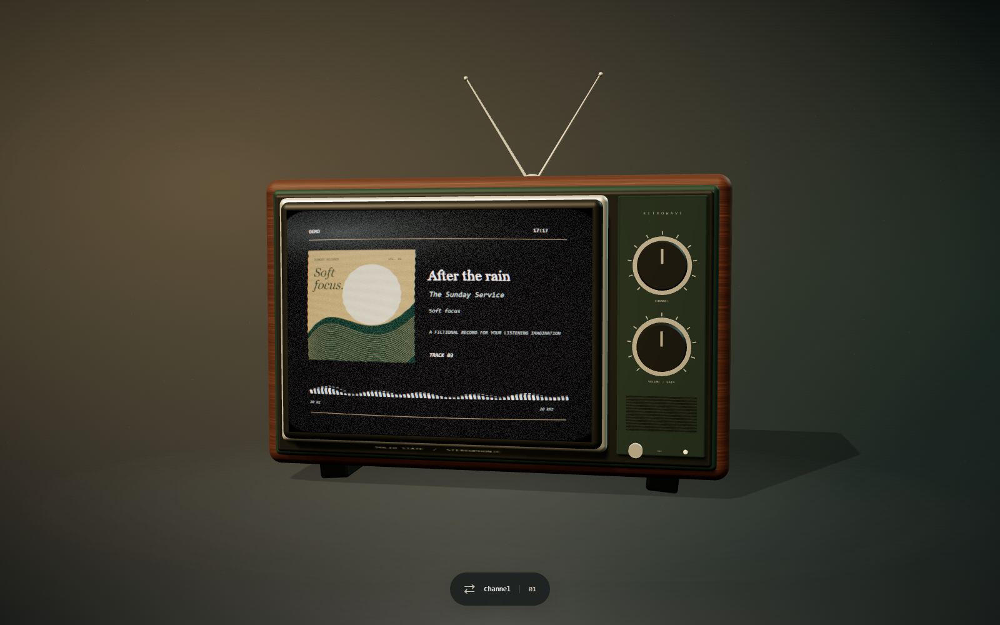

# RetroWave TV

A retro CRT wallpaper for Lively Wallpaper, with a native Windows music companion. Album artwork colors the TV and background; audio drives the visual effects. Synced lyrics, backing vocals and interlude balls scroll in a 45% height area above the TV.

[](https://github.com/iamaloneforever/Lively-wallpaper_Retro_TV/actions/workflows/pages.yml)

**[Latest release](https://github.com/iamaloneforever/Lively-wallpaper_Retro_TV/releases/latest)** · **[Download Windows x64](https://github.com/iamaloneforever/Lively-wallpaper_Retro_TV/releases/latest/download/RetroWave-TV-win-x64.zip)** · **[Wallpaper preview](https://iamaloneforever.github.io/Lively-wallpaper_Retro_TV/)** · **[Actions builds](https://github.com/iamaloneforever/Lively-wallpaper_Retro_TV/actions/workflows/pages.yml)**



The screenshot is a browser demo with fictional track metadata. Actions publishes releases after browser and Windows checks pass on `main`. Until the first release is published, download `retrowave-windows` from a successful Actions run that includes the Windows build.

## Install

1. Install [Lively Wallpaper](https://www.rocksdanister.com/lively/) and open it once.
2. Download and extract `RetroWave-TV-win-x64.zip`, then run `RetroWave-Setup.exe`.
3. Choose an installation folder and options. Windows sign-in startup is optional and off for a new installation.
4. Let setup register the wallpaper in Lively and pair the Windows companion.
5. Play music in an application that publishes Windows media-session metadata. Open **RetroWave** from Start to inspect playback or change settings.

The installer includes the .NET runtime. It is unsigned. Windows 11 x64 is the tested platform; Windows 10 and ARM64 have not been fully qualified.

## Lyrics

Press **S** on the wallpaper and enable **Background lyrics**. Keep the RetroWave companion running for playback timing.

- **Spicy Lyrics:** enter a publishable `sl_pk_…` key from the [developer dashboard](https://developers.spicylyrics.org/dashboard/applications), and allow `https://iamaloneforever.github.io`. A Spotify-format track ID is needed; Music Finder can resolve IDs for other players. Secret keys are rejected.
- **LRCLIB:** enable **Use LRCLIB fallback** in the wallpaper settings. This works with title and artist metadata without a Spotify ID or Spicy key. Lookups send track metadata to [LRCLIB](https://lrclib.net/).

If lyrics cannot be found, a glass **Find your song** picker opens automatically. It shows the full now-playing name and lets you edit only the search title and artist. For example, change “Fly Me to the Moon 2008 version” to “Fly Me to the Moon”. Results refresh as you type; each recording shows its full title, artist, provider and ID. Choose a recording to load its lyrics against the current playback clock. **Find song** also opens the picker manually. Corrections apply to the current song and reset when playback changes.

Catalogue search uses the companion's enabled Music Finder providers, including experimental Spotify when consented. LRCLIB search requires the wallpaper's **Use LRCLIB fallback** setting. Update the Windows companion to use interactive catalogue search.

Working lyrics remain visible while an additional provider lookup is pending, and a manually chosen recording is retained when the companion later resolves another catalogue ID.

The lyric clock advances independently of the 3D render loop and follows native pauses, seeks and playback rate. If a player or recording has a consistent delay, use **Lyric timing adjustment (seconds)** in settings: positive values advance the lyrics and negative values delay them. This adjustment is saved in the JSON settings file.

The finder queries every enabled, configured catalogue source concurrently, including Apple iTunes recording IDs. A slow or failing source does not block later sources. With both lyric sources enabled, Spicy Lyrics and LRCLIB are checked and timed lyrics are preferred over plain text.

Finder results are sorted by a visible score out of 100: title (40%), singer (25%), duration (20%), source popularity weight (10%), and agreement across sources (5%). Missing singer or duration information is excluded from the calculation. Agreement counts distinct sources returning the same recording; repeated rows from one source do not increase it. Each source displays its best result score. In the companion **Music Finder**, save a popularity weight from 0 to 100 for each source, including LRCLIB. These preferences persist in `settings.json`, default to a neutral 50, and represent your preference rather than measured service usage.

Enable **Lyric censorship** in settings to mask common English profanity with asterisks; turn it off to restore the original lyrics. This display preference is saved in the companion JSON.

The full lyrics remain scrollable. Syllable effects, duet alignment, backing vocals and interlude balls are preserved. Untimed lyrics use manual scrolling. Text size, glow, color and reduced effects are adjustable. The lyrics area and TV occupy separate parts of the screen.

## Controls and companion

- Drag the TV to rotate it. Use the channel dial to switch between Vintage Broadcast and Minimal Vinyl.
- **S** opens settings; **Escape** closes them. The power button enters standby; gain changes the visualization intensity.
- The companion shows native playback metadata and the source of catalogue matches. Music Finder configures optional providers; external matching requires consent.
- Closing the companion window leaves its worker running. Dashboard and Diagnostics can stop, restart or quit it. Settings opens repair, relocation and uninstall.

The unpaired website runs a browser demo. `?live=1` disables the demo; real Lively callbacks take priority.

## Persistent settings

Wallpaper and lyric preferences are saved automatically to `%LocalAppData%\RetroWave\wallpaper-settings.json` by the paired Windows companion. This file sits outside the installed binaries, so updates, repairs and restarts keep your preferences. You do not need to configure them again. The wallpaper loads the file automatically and applies changes when the file changes.

On the first connection, existing browser settings are migrated once if the JSON file does not exist. After that, the JSON file is the source of saved settings; browser storage keeps an offline copy. Browser changes made while the companion is unavailable are retried after reconnection. The settings panel reports whether the file has actually been saved. The file contains all television, visual-effects, performance and lyric preferences, including particle movement and scale, imported custom effects and the Spicy **publishable** key; provider credentials and pairing tokens remain separate.

The file uses `{ "version": 1, "config": { ... }, "lyricsKey": "sl_pk_…" }`. A blank lyrics key is supported. You may edit this file while the wallpaper is running; invalid JSON or unsupported values are reported and never replace the last applied preferences. An unpaired browser preview continues using local browser preferences.

## Privacy

Playback is read through Windows media sessions. The companion uses an authenticated localhost bridge; its pairing token is stored in the wallpaper URL fragment. Do not share a paired URL. Provider credentials remain on Windows and are not sent to GitHub Pages. There is no telemetry.

Optional catalogue services and lyrics providers receive metadata when enabled. If the wallpaper asks for local-network access, allow it in Lively's browser profile.

## Help and development

See [troubleshooting](docs/troubleshooting.md) for playback, lyrics, pairing and uninstall help. See [development](docs/development.md) for builds, tests, architecture and release automation.

## Animated backgrounds

The wallpaper now combines subtle sparkles, drifting dust, rain, embers, bokeh, and fireflies in eleven genre-specific combinations over the existing album-color gradient. Genre changes preserve the background colors. Each genre uses multiple atmospheric layers. Live Lively spectrum input gently drives lighting and highlights; time-based motion continues when audio is unavailable. Effects and particle distributions crossfade without rebuilding the 3D scene.

Press **S** → **Background & Visual Effects** to choose automatic genre detection, a manual theme, particle effects, sensitivity, brightness, motion, transition duration, and Low / Balanced / High / Ultra performance presets. Native genre metadata takes priority; optional missing-genre enrichment uses only the companion's consented, enabled MusicBrainz or Apple iTunes providers. A configurable default covers missing metadata. Settings persist through the existing JSON preferences system; update the companion to support the new fields.

Twenty-eight title-and-artist-specific easter eggs add small visual signatures to selected recordings. **Song easter eggs** and **Reduced motion** let you control these. See [background settings, supported genres, easter eggs, and extension guide](docs/backgrounds.md) for details and platform-testing limitations.

## Custom song effects

Press **S → Custom song effects** to download a JSON starter for the current song. Edit its colors, layers and animation, then import it. Mix reactive rings, stars, polygons, waves, grids and particles with keyframes, looping and audio modulation, or write a GLSL fragment shader for completely custom visuals. Effects activate by title and artist; Preview, enable/disable, removal and export controls are included. Reimporting the same ID updates it, and failed imports keep your saved library. Effects overlay the current atmosphere by default; Preview toggles on and off. In Lively, the paired companion saves starters and exports to `%LocalAppData%\RetroWave\exports` and confirms their location.

The paired companion saves custom effects, shaders and enable states in `wallpaper-settings.json`, with the browser as an offline cache. Update the companion to enable this and restore effects across wallpaper updates; export a backup to share them. See the [custom effects guide and examples](docs/custom-effects.md).

## Credits and licenses

This project uses the work of these creators:

- **[Spikerko and Spicy Lyrics contributors](https://github.com/Spikerko/spicy-lyrics):** the vendored lyrics renderer, animations, scrolling and styles, licensed under AGPL-3.0.
- **Special thanks to [Spicy Lyrics Mobile contributors](https://github.com/spicylyrics/mobile)** for their work on experimental Spotify integration.
- **[Fraktality](https://github.com/Fraktality/spr):** the MIT-licensed spring implementation port included in the Spicy renderer.
- **[mrdoob and Three.js contributors](https://github.com/mrdoob/three.js):** the MIT-licensed 3D rendering library.
- **[Adrien Denat / SimpleBar](https://github.com/Grsmto/simplebar), [Tanner Linsley / TanStack Virtual](https://github.com/TanStack/virtual), [Morgan Herlocker / cubic-spline](https://github.com/morganherlocker/cubic-spline), and [Mike Bostock / d3-ease](https://github.com/d3/d3-ease):** scrolling, virtualization and animation dependencies.
- **[rocksdanister and Lively contributors](https://github.com/rocksdanister/lively):** the wallpaper host and callback API.
- **[LRCLIB](https://lrclib.net/), [ListenBrainz](https://listenbrainz.org/) and [MusicBrainz](https://musicbrainz.org/):** optional lyrics and music metadata services.

See [third-party notices](THIRD_PARTY_NOTICES.md) for source versions and licenses. The combined wallpaper is distributed under [AGPL-3.0](LICENSE). The original RetroWave code and native companion retain the [MIT grant](LICENSE-MIT).

The running wallpaper's **Source and licenses** link opens shipped full license
texts, a dated Spicy integration notice, the exact build commit for clean builds,
and a complete corresponding source snapshot. Development builds explicitly avoid
claiming an unrelated commit as their exact source. The source snapshot includes
host adapters, build scripts, workflows and lockfiles. It is also shipped as
`source.zip` with new releases. See the [Spicy modification notice](licenses/SPICY-MODIFICATIONS.md).

The companion's MIT grant applies to independently authored native code. Its
self-contained Microsoft runtime components retain their separate terms. Open
**Licenses** in setup before installation or **About → Licenses** afterwards.
You can extract all embedded materials without installing:

```powershell
.\RetroWave-Setup.exe --licenses --licenses-dir C:\RetroWave-licenses
```

Open `C:\RetroWave-licenses\index.html`. New releases also offer the identical
`RetroWave-licenses.zip` separately; the main installer ZIP continues to contain
one executable. Existing wallpaper registrations receive corrected AGPL metadata
when you run **Install / repair**; unrelated registration settings are preserved.
