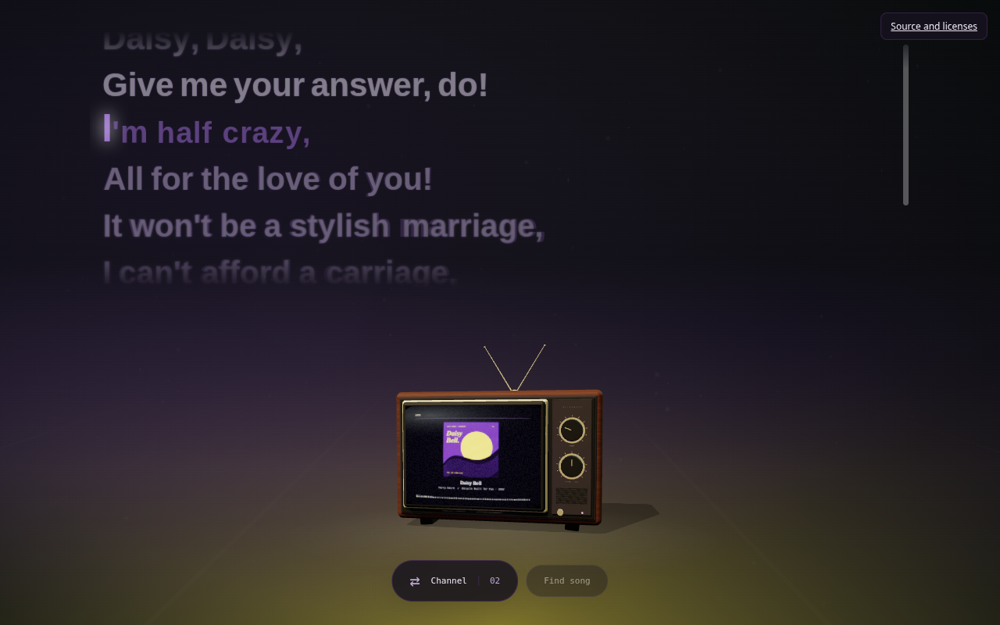
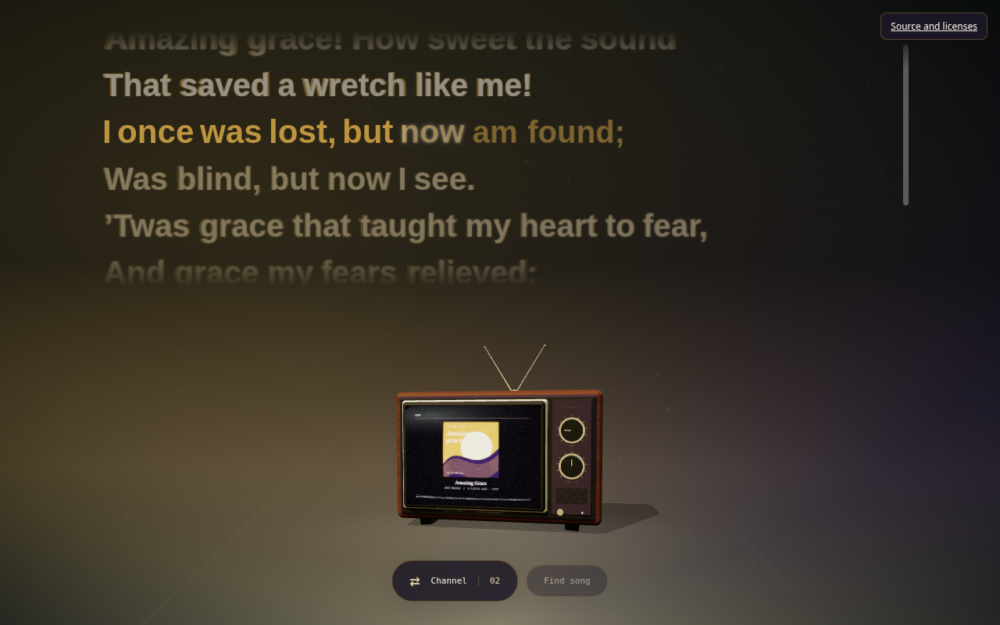

# Spicy Bond

A music wallpaper for **Windows**, built for [Lively Wallpaper](https://www.rocksdanister.com/lively/). A retro television, synced lyrics, album colors and gentle music-reactive effects. The native Spicy Bond companion follows your player through Windows media sessions.

[Get started](docs/getting-started.md) · [Documentation](docs/README.md) · [Watch the demo](docs/media/spicy-bond-demo.mp4) · [Source and licenses](docs/licenses.md)

## See it in motion

| Lyrics and vinyl | Atmospheric effects |
| --- | --- |
|  |  |

The **12-second, 540p, 30 fps** video features the running app, with eased 0.8-second transitions between channel and song changes. The preview is silent: public-domain compositions, artwork and lyric timing authored for Spicy Bond, and simulated spectrum. Your own music and live timing come from the Windows player and companion. [Capture details](docs/media/README.md).

## Install on Windows

1. Install Lively Wallpaper and open it once.
2. Extract `Spicy-Bond-win-x64.zip` and run `SpicyBond-Setup.exe`.
3. Choose your options, then let setup register the wallpaper and pair the companion.
4. Play music and open **Spicy Bond** from Start to inspect playback.

Windows 11 x64 is the qualification target. The unsigned installer includes the .NET runtime. Sign-in startup is optional and off for new installations. See [installation, updates and uninstall](docs/getting-started.md).

Public project destinations are [GitHub](https://github.com/iamaloneforever/Spicy-Bond), [Windows downloads](https://github.com/iamaloneforever/Spicy-Bond/releases/latest) and the [preview website](https://iamaloneforever.github.io/Spicy-Bond/). These new destinations require the repository rename and deployment. Until then, use a successful Actions run's `spicy-bond-windows` artifact or [build locally](docs/development.md).

## Make it yours

- Drag the TV to rotate it; use the channel dial to switch between Vintage Broadcast and Minimal Vinyl.
- Press **S** for settings and **Escape** to close them. The power button enters standby; gain adjusts the visualization.
- Enable **Background lyrics** for synced words, backing vocals and interludes. A publishable Spicy Lyrics client key is preconfigured; your saved override takes priority, including a blank key. [Lyrics and song matching](docs/lyrics.md).
- Choose from eleven atmospheric themes, adjust motion and reactivity, or import a custom song effect. [Backgrounds](docs/backgrounds.md) · [Custom effects](docs/custom-effects.md).
- Preferences survive updates in a companion-managed JSON file. Existing installations retain their settings and pairing. [Settings and migration](docs/settings.md).

The app keeps its existing layout. Spicy Bond's yellow connected-record mark and purple badge identify the website, native companion, installer and project media. This is a Windows desktop project; there is no mobile app or mobile preview.

## Documentation

| Guide | Contents |
| --- | --- |
| [Get started](docs/getting-started.md) | Install, pair, controls, update and uninstall |
| [Lyrics](docs/lyrics.md) | Spicy Lyrics, LRCLIB, timing and recording search |
| [Settings](docs/settings.md) | JSON preferences, privacy and migration |
| [Backgrounds](docs/backgrounds.md) | Themes, particles, song accents and performance |
| [Custom effects](docs/custom-effects.md) | Import, author, preview and export effects |
| [Troubleshooting](docs/troubleshooting.md) | Playback, lyrics, pairing and installation help |
| [Development](docs/development.md) | Architecture, builds, tests and releases |
| [Brand](docs/brand/README.md) · [Media](docs/media/README.md) | Logo, banner, screenshots and smooth video capture |
| [Credits and licenses](docs/licenses.md) | Attribution, terms and corresponding source |

## Credits and licenses

The combined wallpaper is [AGPL-3.0](LICENSE). Independently authored Spicy Bond code and the native companion retain the [MIT grant](LICENSE-MIT); Microsoft runtime components retain separate terms. Full license materials and corresponding source ship with the app.

Thanks to [Spikerko and Spicy Lyrics contributors](https://github.com/Spikerko/spicy-lyrics), [Spicy Lyrics Mobile contributors](https://github.com/spicylyrics/mobile), Fraktality, Three.js, SimpleBar, TanStack Virtual, cubic-spline, d3-ease and Lively Wallpaper. See [complete credits](docs/licenses.md) and [third-party notices](THIRD_PARTY_NOTICES.md).
