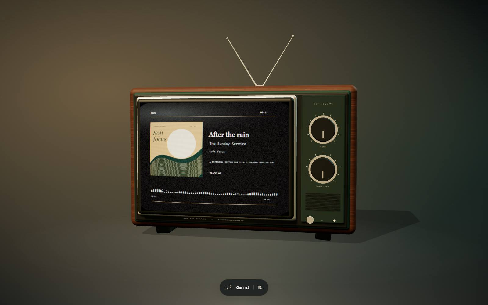

# RetroWave TV

A Three.js retro CRT wallpaper for Lively Wallpaper, with **RetroWave**, a native Windows music companion. Album covers color the television and its surroundings. Optional ghost lyrics follow the playback clock while the original cabinet, analog effects, animations and interaction remain intact.



The wallpaper stays at [the existing GitHub Pages address](https://iamaloneforever.github.io/Lively-wallpaper_Retro_TV/). Users need Lively, but no development tools or separate .NET runtime installation.

## Install

1. Install [Lively Wallpaper](https://www.rocksdanister.com/lively/) and open it once.
2. Extract **RetroWave-TV-win-x64.zip** and run its single **RetroWave-Setup.exe**.
3. Review the destination, defaulting to `%LocalAppData%\Programs\RetroWave`. Edit it or browse to another writable local folder. Setup checks permissions, free space and unsafe paths.
4. Select the playback companion, optional metadata sharing, LRCLIB, desktop shortcut and launch options. **Windows sign-in startup is off for fresh installations.** Existing startup and catalogue consent are preserved during upgrades.
5. Setup detects Store or standard Lively, reuses the existing wallpaper entry, preserves its identity and pairs the authenticated localhost bridge automatically.

The unsigned installer is the same self-contained application as the installed **RetroWave.exe**, with setup selected by its filename. Only one application/runtime bundle is installed. Settings, the Lively installation journal and sanitized logs live separately in `%LocalAppData%\RetroWave`.

Open **RetroWave** from Start. Its Dashboard, Now Playing, Music Finder, Settings, Diagnostics and About sections use native .NET 10 WPF controls and Fluent styling. Windows 11 Mica is requested when supported and transparency is enabled; older systems and high contrast use opaque surfaces. Light, dark and system themes are available. No WebView hosts the management interface.

**Compatibility:** the native API target declares Windows 10 build 17763 (1809) as its minimum, but .NET 10's supported operating systems must also be considered. This release was exercised on Windows 11 x64; Windows 10, ARM64, multiple DPI scales and real sign-in still require release qualification. See the [implementation and verification report](docs/retrowave-4-report.md).

## Lifecycle and installation management

Closing the management window leaves the worker running. Dashboard and Diagnostics can start, restart or stop it, or explicitly quit both. A per-user mutex rejects duplicate worker instances. Windows startup invokes `RetroWave.exe --run` without opening the UI. Startup can be changed in Settings without elevation.

Settings shows the installation and data folders. **Repair, relocate or uninstall** opens setup and closes the management window so Windows can replace files. Change the destination in setup to relocate an owned installation. Relocation keeps settings and pairing, updates registration and shortcuts, and rolls back its file/registration transaction on failure. Source binaries are removed after setup exits; unrelated files are kept. Close any other RetroWave management windows before an upgrade.

Setup rejects destination collisions, drive roots, junctions and symbolic links. Ordinary installation is per user. A protected destination is rejected with an explanation rather than silently requesting elevation. Moving Lively's own library still requires uninstalling the wallpaper registration before reinstalling it against the new library.

## Transparent metadata and matching

Now Playing displays artwork, native title/artist/album, album artist, track number and genres when supplied, duration/position/status/rate, publishing app, Spotify ID, recording MBID, ISRC, confidence and update time. Fields can be copied individually. Missing fields remain marked as not provided.

Native playback fields remain attributed to **Windows GSMTC / the publishing application**. Recording identities and Spotify-ID providers have separate provenance. A Spotify ID does not turn native metadata into Spotify metadata. The wallpaper reports actual Spicy Lyrics or LRCLIB receipt through an authenticated, bounded status endpoint; older wallpaper builds leave the lyrics source unreported.

Music Finder shows provider purpose, enablement, last request, last successful match, error category and scored candidates/rejection reasons. Providers can be reordered, tested against the current song, and configured. External matching needs explicit consent in Privacy.

| Provider | Purpose | Default |
| --- | --- | --- |
| [ListenBrainz](https://labs.api.listenbrainz.org/spotify-id-from-metadata) | Spotify IDs from metadata or a recording MBID | Enabled behind catalogue consent |
| [MusicBrainz](https://musicbrainz.org/doc/MusicBrainz_API) | Recording MBID, releases, duration, credits, ISRC and disambiguation | Enabled behind catalogue consent |
| Experimental Spotify | Independently implemented embed-session and `searchDesktop` lookup; undocumented and fragile | Disabled; separate consent required |
| [ACRCloud](https://docs.acrcloud.com/reference/metadata-api) | Metadata/ISRC and cross-platform Spotify IDs | Disabled; personal bearer token required |
| [Official Spotify](https://developer.spotify.com/documentation/web-api/reference/search) | Supported catalogue search and ISRC queries using OAuth PKCE | Disabled; personal developer app and access required |
| [Apple iTunes](https://developer.apple.com/library/archive/documentation/AudioVideo/Conceptual/iTuneSearchAPI/) | Supplementary metadata verification; Apple IDs are never Spotify IDs | Disabled |
| [LRCLIB](https://lrclib.net/docs) | Synchronized/plain lyrics independent of Spotify IDs | Separate opt-in fallback |

The resolver checks a bounded in-memory cache, follows provider order and stops after an accepted Spotify ID. MusicBrainz recording matches can feed ListenBrainz's MBID resolver. Concurrent identical searches share a result; obsolete searches are cancelled on track/settings changes. Positive results expire after six hours, negatives after five minutes, with at most 256 cached entries. Restarting the worker clears caches. Tokens are not cached alongside metadata.

The matcher normalizes Unicode, punctuation, case, browser title noise and artist variants. The baseline weights are title 55%, artist 30%, duration 15%, with 82 overall, 0.78 title, 0.55 artist, eight-second duration tolerance and four-point winner margin. Missing duration is excluded from the observed-field score rather than fabricated. ISRC/MBID agreement strengthens a match; conflicting identities or recording versions reject it. Live, remix, acoustic, instrumental, remaster, slowed and sped variants remain distinct. Missing/different album editions do not automatically veto a match. Ambiguous results are not silently replaced by the first ID.

Provider timeouts and HTTP 429 backoff are separate from the playback clock. MusicBrainz calls are spaced at least 1.1 seconds apart per resolver client and identify RetroWave in User-Agent. Multiple clients on the same machine should avoid simultaneous manual tests against MusicBrainz.

## Lyrics

Press **S** on the wallpaper and enable **Background lyrics**.

- **Spicy Lyrics:** save a browser publishable `sl_pk_…` key and allow `https://iamaloneforever.github.io` in the [Spicy developer dashboard](https://developers.spicylyrics.org/dashboard/applications). Secret keys are rejected. Spicy needs a Spotify-format ID, which catalogue matching can supply for another player.
- **LRCLIB:** enable **Use LRCLIB fallback** in the wallpaper. This switch controls wallpaper lookups even when RetroWave Privacy allows LRCLIB. Turning it off stops fallback requests and clears fallback lyrics. It sends title, artist, album and duration to LRCLIB. Exact lookup is followed by a validated search fallback; competing matches remain ambiguous. It works without Spotify installation, login, ID or Spicy key, including when Spicy fails.

The worker samples GSMTC at 5 Hz. The wallpaper polls at 2 Hz and interpolates from timestamped snapshots. Pause freezes animations, seek resets their anchor, and missing/stale clocks hide lyrics. Provider requests never stop the clock. Five neighboring lyric lines reuse elements; Motion animates line placement and native animations follow word timings. Untimed lyrics remain static, joining scripts retain word shapes, and reduced motion/Lively pause suspend effects.

The experimental Spotify implementation was written independently after reviewing the reference project's API behavior. Its AGPL source is not incorporated. Anonymous tokens remain in worker memory and never reach GitHub Pages. The provider performs no account credential collection, challenge solving or access-control bypass. Changed APIs, denied access and rotated query identifiers produce unavailable results and allow later providers/fallback to continue.

Official Spotify uses a user-supplied client ID, browser authorization and PKCE. Register `http://127.0.0.1:43822/callback` in that developer app. Spotify's developer access restrictions still apply. ACRCloud uses the documented EU metadata endpoint and a personal bearer token. Optional credentials and OAuth refresh tokens use Windows Credential Locker. No shared production secret is shipped.

## Lively and local security

The hosted wallpaper uses the existing URL, Three.js and native Lively audio/metadata callbacks. Setup retains the actual URL-wallpaper schema (`Type: 3`) and arguments:

```text
--audio --system-nowplaying --pause-event true
```

The bridge binds only `127.0.0.1:43821`, validates Host and an exact origin allowlist, requires the pairing header, bounds connections/headers/body sizes and applies timeouts. `/now-playing` remains compatible, with additive provenance fields. `/inspector` exposes matching detail under the same authentication. Artwork is requested separately and cached by the UI. `/lyrics-status` accepts only an authenticated status receipt tied to the current track, not playback or installation commands.

Pairing is carried in the wallpaper URL fragment, which is not sent to Pages. Do not share a paired URL. Provider credentials and Spotify tokens are never included in bridge responses or logs. Diagnostics omit titles, artists, artwork, credentials and full authenticated URLs. Logs rotate at 256 KiB. No telemetry is enabled.

**Local-network permission:** allow the hosted origin if the browser profile prompts. Lively's profile is separate from Edge. Some hosts need upstream browser support to expose this prompt. Setup does not disable browser security, alter enterprise policy or change firewall rules. Audio and metadata visualization continue without the bridge.

Every GSMTC publisher is eligible; there is no fixed player allowlist. The current playing session wins, followed by another playing session before a paused one. Player versions/configurations must publish a usable timeline. No audio fingerprinting or playback controls are added.

## Wallpaper controls

- Drag the television to rotate it; pointer motion adds parallax.
- Channel/dial switches Vintage Broadcast and Minimal Vinyl.
- TV power enters standby. Gain adjusts visualization rather than system volume.
- **S** opens visual, performance and lyrics settings; Escape closes them. The fixed header stays available while controls scroll by wheel, scrollbar, keyboard or touch. Scene interaction is disabled while settings are open.
- Lyrics appearance offers Smooth (default), Classic and Minimal motion, text size, intensity and automatic/neutral color. Reduced motion and low power keep synchronized highlights while removing word movement. Only provider-timed segments receive karaoke; line-only and static lyrics keep their true timing granularity.
- See the [wallpaper polish verification report](docs/wallpaper-polish-report.md) for screenshots, root causes and browser versus live-host qualification.
- The ordinary URL offers a fictional demo without host callbacks. `?live=1` disables it; real callbacks take priority.

Host input forwarding and desktop icons can affect clicks. Settings require local storage; WebGL2 and hardware acceleration are recommended. The existing canvas fallback remains available.

## Architecture and development

The single C# application has independent process modes for WPF management, headless worker and lightweight WinForms setup. `MediaMonitor`, `TrackResolver`, `Music/`, `LoopbackServer`, `AppSettings`, `InstallationFiles`, `WallpaperInstaller` and `WindowsSetup` separate observation, matching, network transport, preferences and installation. Setup shares the published runtime rather than embedding a second runtime bundle.

Developers need Node.js 24, pnpm 11.19.0 and the .NET 10 SDK on Windows. End users do not.

```powershell
pnpm install --frozen-lockfile
pnpm typecheck
pnpm test
pnpm build
pnpm exec playwright install chromium
pnpm test:e2e
dotnet run --project companion/tests/RetroWave.Companion.Tests -c Release
dotnet run --project companion/tests/RetroWave.UI.Tests -c Release
./scripts/build-windows.ps1
./companion/tests/package-smoke.ps1
```

`-DotNet <path>` selects another SDK. `-Offline` permits cached-package publishing without NuGet vulnerability retrieval; normal CI retains auditing. `-Runtime win-arm64` requests ARM64 publishing, which is not certified on ARM64 hardware. Branding source includes SVG, icon generation and version-resource generation; checked-in `.ico`/`.res` resources make ordinary builds independent of a resource compiler. After changing icon/version resources, run `scripts/build-icon.ps1` and `scripts/build-branding.ps1` with a Windows SDK resource compiler.

Vite serves `wallpaper/`, writes `dist/` and preserves the `/Lively-wallpaper_Retro_TV/` base. Preview uses port 4173. Installed Edge can run tests with `$env:PLAYWRIGHT_CHANNEL='msedge'`. The Pages workflow validates web/native tests and uploads one Windows installer ZIP. Pull requests do not deploy.

Package/UI tests use isolated `RETROWAVE_DATA_ROOT` and `RETROWAVE_BRIDGE_PORT` overrides, including isolated mutex/event names, to preserve the real installation. These are development overrides; normal launch uses the documented per-user folder and port. `scripts/benchmark-windows.ps1` measures the new isolated worker and samples an existing legacy worker without stopping it. See [measured results and limitations](docs/retrowave-4-report.md).

## Troubleshooting and uninstall

| Symptom | Action |
| --- | --- |
| No sessions or timeline | Open a compatible player; check Diagnostics. A player may supply metadata without timing. |
| No Spotify ID / ambiguous result | Inspect Music Finder candidates; enable LRCLIB independently. |
| Provider unavailable | Check consent/configuration, connectivity and provider backoff. |
| Spicy 401/403 | Check the publishable key and allowed origin. Opted-in LRCLIB can still work. |
| Local bridge disconnected | Start/restart the companion or repair setup. Allow local-network access in the wallpaper profile. |
| Port already in use | Close the old PowerShell companion. Unrelated processes are not terminated. |
| Lively not detected | Use Store/standard Lively, open it once and confirm its configured library exists. Portable/custom host locations are not detected. |

Uninstall **RetroWave** in Installed Apps or use setup. The worker stops, owned startup/uninstall entries and shortcuts are removed, and only owned binaries/wallpaper files are cleaned up. A reused wallpaper's original metadata is restored only if it has not been edited since setup. Unrelated files remain. Setup's cleanup helper waits for its process to exit; an in-use binary may need other RetroWave windows closed. Application preferences/logs and Windows Credential Locker entries are retained; disconnect optional credentials in Music Finder when desired. Browser preferences and keys remain in the wallpaper profile. Close/replace the running wallpaper in Lively after uninstalling it.
