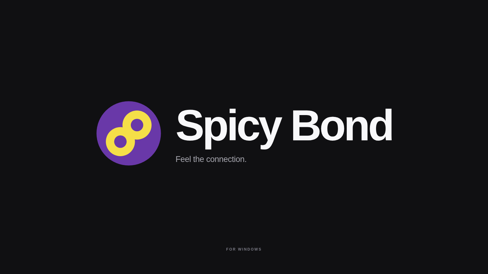

# Spicy Bond documentation

Spicy Bond is a Windows music wallpaper for Lively Wallpaper with a native companion. Start with installation, then tune lyrics and effects to your music.

| Guide | What you can do |
| --- | --- |
| [Get started](getting-started.md) | Install, pair, use controls, update and uninstall |
| [Lyrics and song matching](lyrics.md) | Configure providers, find recordings and adjust timing |
| [Settings and migration](settings.md) | Save preferences, move installations and understand privacy |
| [Backgrounds](backgrounds.md) | Choose themes, motion, audio response and performance |
| [Custom song effects](custom-effects.md) | Import, author, preview and export JSON/GLSL effects |
| [Troubleshooting](troubleshooting.md) | Diagnose playback, lyrics, pairing and installation |
| [Development](development.md) | Build and test the wallpaper and Windows companion |
| [Brand identity](brand/README.md) | Use the current logo, banner, palette and shared metadata |
| [Media capture](media/README.md) | Recreate screenshots and the finished 30 fps demo |
| [Credits and licenses](licenses.md) | Read attribution, distribution terms and source information |
| [Historical distribution review](licensing-distribution-review.md) | Inspect the licensing findings for older releases |

The browser preview is silent and uses public-domain songs with simulated audio response. Live playback requires Windows media-session metadata and the companion. The original wallpaper layout is retained; the project has no mobile edition.

[Back to project](../README.md)
