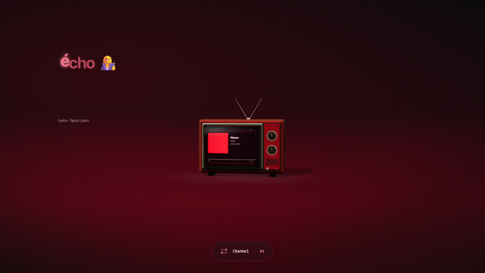

# Cover color and character motion

Automatic lyrics used to mix 90–95% white into every cover swatch. They now choose a colorful cover swatch, lift its brightness while retaining its hue, and add only enough white to keep dark colors usable. Neutral remains explicitly white. Surrounding lines and waiting characters also use the cover hue.

Smooth mode applies individual color, lift, scale and glow effects to Unicode graphemes. Combining accents and joined emoji remain intact. Native animations follow the existing companion clock, pause, seek and playback rate. Effects are staggered within each supplied syllable range. Line-only lyrics receive a decorative wave within the supplied line range. These visual subdivisions are approximate; the provider's original timestamps are unchanged and no character timestamps are attributed to the provider.

Persian, Arabic and other supported joining scripts keep inline glyphs and animate color/glow without transforms that disconnect letters. Classic, Minimal, low power and reduced motion suppress character lift/glow while keeping timed color changes. Untimed lyrics remain static. Animation work is bounded to 320 graphemes per row; unusually long text retains its original segment effect and content.

Verification: TypeScript, production build, all 36 unit tests and all 23 lyric browser checks passed in installed Edge. Final color/readability and grouping refinements passed five focused browser checks. The tests check actual cover hue, different character delays/poses, pause/seek, neutral color, Unicode, RTL shaping rules, line timing, low power, stale data and provider fallback. Browser fixtures do not establish real Lively/GSMTC integration. The screenshot below uses a fictional track and a red cover fixture.

