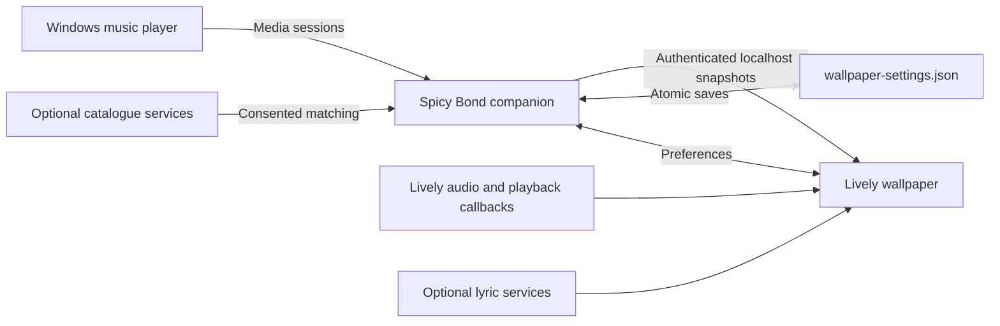

# Develop Spicy Bond

[Documentation](README.md) · [Brand](brand/README.md) · [Media capture](media/README.md)

## Toolchain and local preview

Use Node.js 24, pnpm 11.19.0 and the exact .NET SDK in [global.json](../global.json), currently 10.0.402. Run commands from the repository root.

```powershell
pnpm install --frozen-lockfile
pnpm dev
```

Open the URL printed by Vite with `/Spicy-Bond/` appended. The browser preview is silent, uses public-domain songs and requires no Windows playback or provider calls. Add `?live=1` to wait for actual callbacks. The app retains its existing layout; branding is applied through identity metadata, artwork and native resources.

```powershell
pnpm test
pnpm docs:check
pnpm build
pnpm test:packaging
pnpm exec playwright install chromium
pnpm test:e2e
```

`pnpm build` verifies branding, regenerates the Spicy renderer, typechecks, builds both the wallpaper and showcase, then checks the final distribution. `pnpm preview` serves `dist/` on port 4173. `VITE_BASE_PATH` overrides the default `/Spicy-Bond/` for both Vite and browser tests; Actions derives it from the actual repository name. `PLAYWRIGHT_CHANNEL=msedge` selects an installed Edge for tests.

## Source map

| Location | Responsibility |
| --- | --- |
| [branding.json](../branding.json) | Shared display name, package/native IDs, destinations, tagline and palette |
| [Brand.ts](../wallpaper/src/core/Brand.ts) | Browser identity, publishable lyrics key and legacy preference migration |
| [App.ts](../wallpaper/src/core/App.ts) | Existing wallpaper controls, playback and scene orchestration |
| [background](../wallpaper/src/background) | Genre environments, particles, transitions and custom effects |
| [lyrics](../wallpaper/src/lyrics) | Playback clock, conversion and provider integration |
| [spicy-host](../wallpaper/vendor/spicy-host) | Adapters for the unchanged vendored Spicy Lyrics renderer |
| [SpicyBond.Companion](../companion/src/SpicyBond.Companion) | WPF management UI, native worker, media sessions and authenticated bridge |
| [SpicyBond.Setup](../companion/src/SpicyBond.Setup) | Installation, repair, relocation and removal |
| [LivelyInfo.json](../lively/LivelyInfo.json) | Hosted wallpaper registration and required Lively callback arguments |
| [showcase](../wallpaper/showcase/index.html) | Windows media page using the current banner, logo, captures and video |
| [scripts](../scripts) | Brand synchronization, builds, captures, source and license checks |



The bridge listens on `127.0.0.1:43821`. It validates Host and origin and requires the compatibility header `X-RetroWave-Key`. Credentials never leave the companion. Native playback observation is independent of catalogue requests. See [settings and migration](settings.md) before changing any persistent IDs or protocol identifiers.

## Update branding

Edit `branding.json` for identity metadata. The primary vector is [logo.svg](../wallpaper/public/brand/logo.svg); `mark.svg` is its standalone symbol.

```powershell
pnpm brand:sync
pnpm brand:artwork
pnpm brand:check
```

`brand:sync` updates documentation/native SVG copies, `Branding.g.cs` and `Branding.props`. `brand:artwork` also renders PNG, cover, size preview and the seven-size ICO, then rebuilds the Win32 resource. It needs Chromium. `brand:resources` only rebuilds the resource from the existing ICO and manifest. Native version metadata follows the companion project's Version.

Builds check generated files without rewriting them, so a stale logo copy, native name or resource fails before distribution. Vite substitutes shared metadata into the wallpaper and showcase HTML, including a cover URL derived from the active base path. [Full brand guide](brand/README.md).

## Build the Windows companion

Native execution and UI tests require Windows. Linux can cross-compile, run portable registration/licensing tests and inspect a packaged executable; these checks do not establish actual Windows playback or WPF behavior.

On Windows:

```powershell
dotnet run --project companion/tests/SpicyBond.Companion.Tests -c Release
dotnet run --project companion/tests/SpicyBond.UI.Tests -c Release
./scripts/build-windows.ps1
./companion/tests/package-smoke.ps1
dotnet run --project companion/tests/SpicyBond.Licensing.Tests -c Release
```

Use the packaging script for distributions. `-DotNet <path>` selects an SDK; `-Runtime win-arm64` builds an unqualified ARM64 package. `-Offline` uses cached packages without NuGet audit retrieval; normal CI retains auditing. Tests use isolated data roots and bridge ports.

The output is `artifacts/Spicy-Bond-win-x64.zip`, containing only `SpicyBond-Setup.exe`. The self-contained executable embeds the runtime and full license materials. `artifacts/SpicyBond-licenses.zip` contains the same embedded materials separately.

The packaging script inventories actual MSBuild copy-local inputs and the SDK host, collects original licenses/notices plus the reviewed native terms, and requires the embedded bundle during publishing. `SpicyBond.PackageAudit` opens the actual release ZIP, parses all .NET bundle entries, decompresses assemblies/native files, checks license and AGPL metadata, and accounts for runtime inputs by hash. The patched native host is recorded separately; this is not an independent audit of its internal native code. The Windows smoke test executes extraction from the shipped executable and checks setup/worker behavior.

## Source and license distribution

Every web build ships full terms, dependency provenance and a complete corresponding source snapshot in `dist/licenses/`. The final-output check compares shipped materials and source bytes against actual inputs, checks retained JS notices and validates local links and metadata. [License guide](licenses.md).

Clean builds identify the exact Git commit. Dirty trees, live servers and exported source without Git metadata are labeled development builds and still include their real source snapshot. `SPICY_BOND_RELEASE=1` rejects an uncommitted or development source tree. To rebuild a source ZIP, unpack it, enter `SpicyBond-source`, install with the frozen lockfile and run the normal build commands.

## Continuous integration and releases

The [workflow](../.github/workflows/pages.yml) runs unit, documentation, packaging and portable native checks, plus eight browser-test shards with one WebGL worker per runner. Native changes, shared branding changes and manual runs also build and test Windows. Pull requests validate without publishing.

On `main`, Pages waits for browser checks and any required Windows checks. A freshly built Windows package is then released with its license ZIP and the web build's `source.zip`, under `build-<run number>`. Select **Run workflow** on `main` to produce a new checked installer. A repository rename does not rename old release assets; publish a fresh build for the Spicy Bond filenames.

The remote repository must be renamed to `Spicy-Bond` and Pages deployed before the new canonical public URLs are available. The repository-derived CI base works before and after that rename. Browser screenshots and traces stay in `test-results/`; checked-in promotional captures are documented in [media capture](media/README.md).
