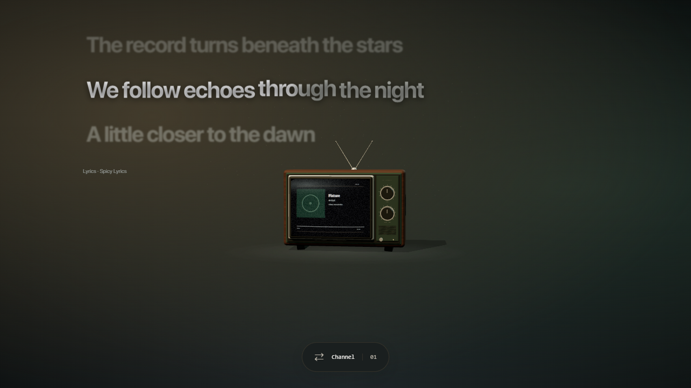

# Lyrics and settings fixes — 14 October 2026

The lyrics now use transparent rows, left-aligned text, dimmed and blurred neighboring lines, and a timed sweep clipped to the syllable text. The supplied [Spicy Lyrics preview](https://raw.githubusercontent.com/Spikerko/spicy-lyrics/main/previews/wide_home.webp) informed the styling. No source implementation was copied.

Opening settings no longer inserts a 125 ms delay and skips eight eligible animation frames. The scene continues at the selected cadence; settings reduce its pixel density to limit rendering cost. Focus uses `preventScroll`.

Settings handle both input and change events, including change-only host events. Storage writes are verified by reading them back, and the panel reports whether settings were saved or apply only for the current session. Hosts that disable local storage still cannot persist settings through this mechanism.

The wallpaper's LRCLIB switch now controls fallback requests independently of the companion's permission flag. Turning it off cancels the current lyric generation and clears displayed fallback lyrics; it stays off on reload. Disabling background lyrics also hides the layer immediately.

## Verification

- TypeScript and the production build passed.
- All 33 unit tests passed.
- 32 affected Edge browser checks passed across the suite and focused reruns. Checks cover reload persistence, every toggle, change-only events, blocked storage reporting, comparable scene cadence with settings open/closed, LRCLIB off despite companion permission, smooth intermediate line positions, provider timing, pause/seek, RTL, and transparent text highlighting.
- The cadence check compares actual WebGL draws per second; it does not assume the monitor's requestAnimationFrame rate equals the chosen FPS.
- The preview below was visually inspected. It uses fictional lyrics and mocked playback/provider responses.

These are local browser results. This turn did not publish GitHub Pages or verify the installed Lively host, real playback, or storage persistence inside that host.
