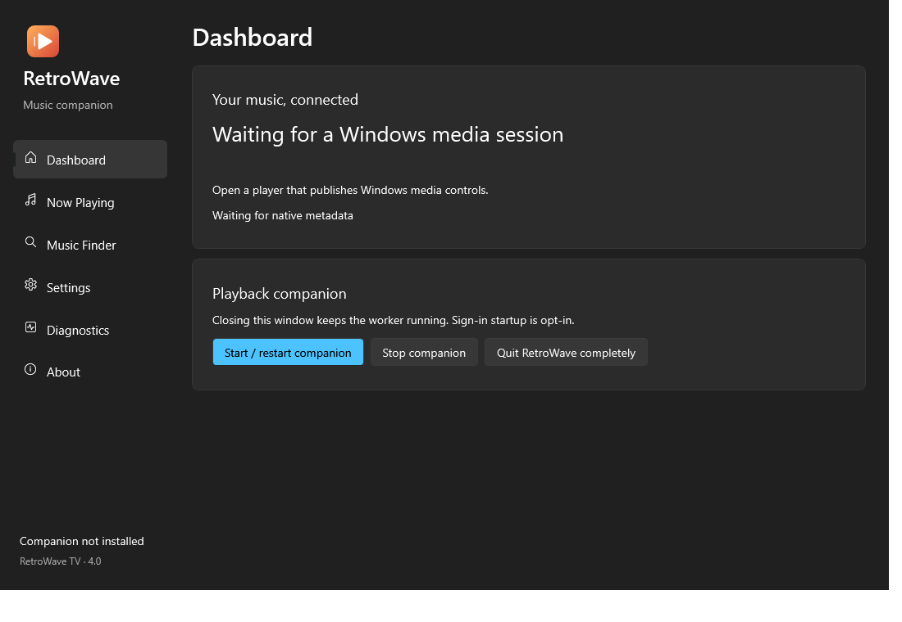
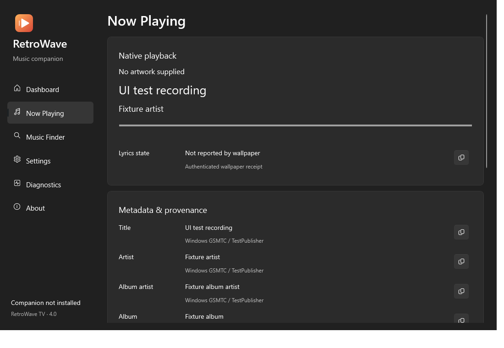
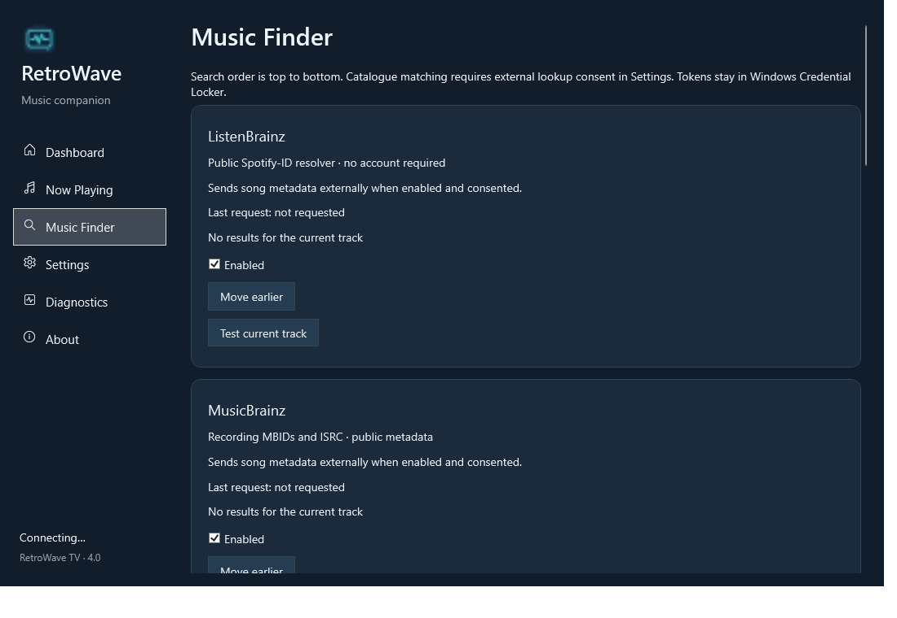
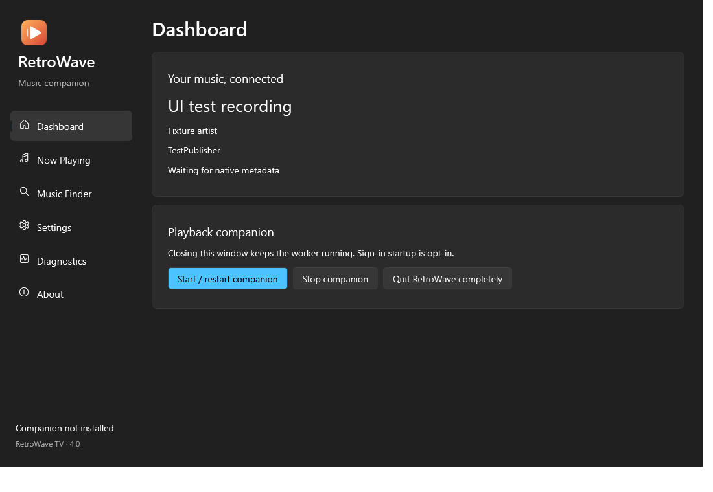
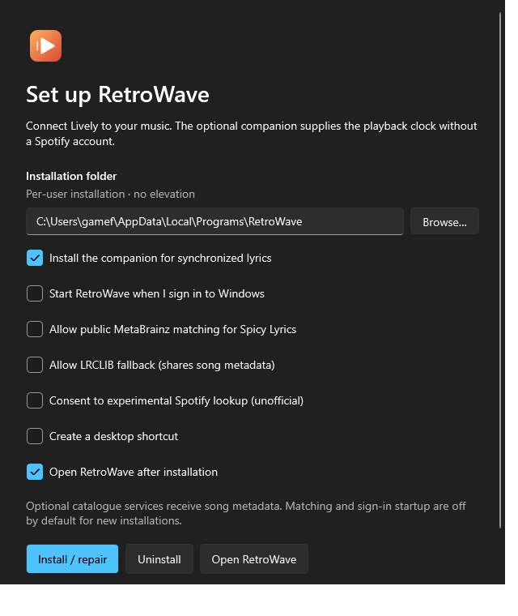

# RetroWave 4.0 implementation and verification

This branch implements a native RetroWave management app, modular catalogue resolution and a consolidated self-contained installer. The build is unsigned. It is reviewable implementation work with the remaining qualification limits below; it is not a claim of universal player/provider/Windows compatibility.

## Architecture and features

- One .NET 10 application, with separate processes selected by default UI launch, `--run`, `--stop`, `--diagnose`, `--setup`, `--install` and `--uninstall`. `--debug` remains a compatibility alias for opening the new UI. No UI-specific initialization occurs in worker mode.
- Native WPF Fluent interface with six navigation sections, artwork and provenance inspection, field copying, provider configuration/order/testing, persistent preferences, worker lifecycle actions and sanitized reports.
- GSMTC observation still supports arbitrary publishers and simultaneous sessions. The 5 Hz playback clock remains separate from asynchronous provider calls.
- Matcher and provider adapters separate candidate discovery, scoring, recording identity and Spotify-ID resolution. The bounded cache keeps positive/negative results in memory, deduplicates work and honours cancellation.
- ListenBrainz metadata/MBID routes, MusicBrainz, experimental Spotify, ACRCloud, official Spotify PKCE, Apple verification and independent LRCLIB fallback are implemented.
- Per-user install destination, free-space/write checks, startup opt-in, shortcuts, legacy migration, repair and a tested file/registration relocation transaction. User data is separate from executable location.
- Application-owned SVG, seven-size ICO, manifest and native version resources. Windows properties identify RetroWave TV, RetroWave.exe and version 4.0.0. No signing certificate is claimed.
- Existing authenticated loopback fields remain compatible. Inspector detail and a bounded authenticated lyrics-status receipt are additive. Neither API response contains credentials or Spotify session tokens.

## UI technology decision

Both a minimal self-contained WinUI 3 evaluation and the implemented WPF application were published using the local .NET 10.0.401 SDK, x64. The WinUI probe used Microsoft.WindowsAppSDK 1.8.260209005 with self-contained unpackaged deployment and native XAML controls, not a browser.

The WinUI probe output total was **222,339,721 bytes across 507 files**. The consolidated WPF single-file application is approximately **67.8 MB**. The probe used the umbrella SDK package, including optional AI/ML/widget runtime assets; a carefully scoped WinUI distribution could be smaller. This is a measured packaging comparison, not an equal-feature WinUI/WPF performance benchmark. WPF was selected to keep the existing native integration, reliable single-installer flow and substantially reduce runtime duplication without adding Windows App SDK deployment prerequisites.

Native WPF `ThemeMode` is evaluation-tagged by .NET 10. Its use is isolated with a scoped WPF0001 suppression. Opaque, high-contrast and Windows 10 fallback surfaces exist. Mica is requested through DWM only when the OS/transparency settings support it. No custom animation timer or WebView is introduced. The app retains the native branded window frame. A tray icon and separate small worker executable were not added; UI and worker processes already have independent lifecycles.

## Measurements

Final measurements from the shipped x64 artifact are recorded below. MB values use decimal units. Single-file extraction, caches, settings and wallpaper data are excluded from binary installation totals unless stated separately. Old size measurements are fresh publishes of the repository's starting 3.0 source, using the same SDK.

| Metric | Old | New |
| --- | ---: | ---: |
| ZIP download | 104,682,996 bytes | 62,126,351 bytes (40.7% smaller) |
| Installer executable | 116,039,390 bytes | 67,827,000 bytes (41.5% smaller) |
| Installed binary files | 174,017,673 bytes (setup + worker) | 67,827,000 bytes (61.0% smaller) |
| Worker working set after warm-up/sample | 162,652,160 bytes | 134,094,848 bytes |
| Worker CPU seconds per 20-second sample | 0.03125 seconds | 0.21875 seconds |
| Worker startup to authenticated bridge | Not measured; existing worker preserved | 876 ms |

The old runtime figures are the earlier 3.0 sample recorded before this refinement. The legacy process was unavailable during the latest measurement, so the old and new runtime figures are not simultaneous samples. The test never starts or stops that legacy process. The new sample uses an isolated data folder, separate bridge port, catalogue matching disabled and a 15-second warm-up. Working set is one endpoint sample and CPU is accumulated process CPU time, not percentage of machine capacity. A single startup sample does not establish cold/warm startup distributions. The new worker used more CPU in this short sample; no CPU reduction is claimed. These brief samples do not establish sustained-idle or active-provider performance improvements. The earlier old process reported file version 3.0.0.0.

Publishing uses compression, no application ReadyToRun and no aggressive trimming/AOT. The installer installs one runtime bundle, rather than embedding another self-contained executable. Single-file native extraction still has disk/startup cost; the distribution is not an 67.8 MB total-disk guarantee. A native bootstrapper/shared-directory deployment and tightly scoped WinUI packages remain possible future comparisons.

## Provider verification

| Provider | Implemented path | Verification |
| --- | --- | --- |
| ListenBrainz | Metadata and recording MBID to Spotify IDs | Deterministic native adapter tests; live public metadata endpoint returned valid candidate arrays through Node; the native live request timed out |
| MusicBrainz | Recording search, credits/releases/duration/ISRC/disambiguation; feeds MBID resolver | Native fixture tests; live public JSON response verified; native live run parsed 11 candidates and conservatively returned ambiguous |
| Experimental Spotify | Bounded embed-session extraction, short-lived memory token, pathfinder search, one 401 refresh, candidate parser | Deterministic request/token-privacy tests; no live anonymous authenticated search certification |
| ACRCloud | Personal bearer token; metadata or ISRC; EU cross-platform Spotify mapping | Deterministic response fixture; no real account credential supplied |
| Official Spotify | PKCE authorization/refresh; track/artist and ISRC searches | Deterministic search fixture; OAuth not authorized against a user developer app |
| Apple iTunes | Public supplementary song verification; never produces a Spotify ID | Native response fixture; live endpoint JSON verified; native live run parsed 12 candidates and returned ambiguous |
| LRCLIB | Exact lookup and validated, ambiguity-aware search fallback; synchronized/plain lyrics | Parsing/network fixtures, browser regression tests, live public endpoint response |

The public reference sample can return multiple Spotify IDs and MusicBrainz recordings. These are intentionally reported as ambiguous when they cannot be disambiguated. Endpoint reachability does not establish recording-level correctness. No provider is claimed to identify every song. LRCLIB is available independently.

The AGPL reference was inspected to understand the protocol. The native algorithm/adapters were written independently; no reference source code is bundled. The persisted-query identifier is an API protocol fact and can rotate. No credentials, account passwords, challenge solving or access-control bypass are used by the experimental provider.

## Tests and compatibility

- 90 deterministic C# checks passed: native clocks/pause/seek, arbitrary session selection, normalization/versions/identity rejection, provider schemas, consent, cache/deduplication, cancellation, HTTP 401/429, malformed/oversized JSON, authenticated bridge/receipt bounds, custom Unicode paths, repair/restoration and relocation failure rollback.
- 20 native UI checks passed: launch/title, all navigation sections, metadata state, theme persistence, minimum resizing and rendering surface. Screenshots are native WPF renders; the metadata-populated screenshot uses a labelled test fixture, not a live-song claim.
- 26 wallpaper unit tests and 18 Edge browser regressions passed. The final build, native UI, shipped-artifact smoke checks and all 18 Edge browser tests passed.
- Actual shipped executable smoke checks cover worker startup, duplicate rejection, UI close without worker exit, sanitized report, worker stop, the one-entry release ZIP and setup wizard launch.

The host is Windows 11 x64. The native target's minimum API is Windows 10 build 17763, but the .NET 10 supported OS matrix and servicing state also govern support. No Windows 10 1809 runtime certification is claimed. ARM64 is a build option, not hardware-certified. Real TIDAL/Apple Music/MusicBee/browser pause/seek behavior, actual Windows sign-in, elevated/protected folder scenarios and multiple monitor DPI transitions remain manual qualification tasks.

The pre-existing real RetroWave/Lively installation was preserved during testing. Disposable-library/file transactions test install/repair/uninstall and rollback. The 4.0 upgrade's actual Start menu, registry, complete migration and uninstall have not been exercised end to end against that real installation; such coverage must not be inferred from filesystem mocks. Store/standard Lively detection and original wallpaper integration remain in place. Hosted browser permission remains outside setup's control.

## Security and remaining limits

- Origin/Host checks, pairing authentication, loopback binding and bounded connections remain in force. Lyrics receipts accept only the supported source categories and current-track identity.
- Music titles/artwork remain in live UI/provider memory; diagnostic files omit them. Credentials/refresh tokens use Windows Credential Locker; catalogue caches never store tokens.
- New installations default startup and metadata sharing off; experimental lookup requires a second consent. Repair/upgrades preserve previous choices.
- No telemetry, host firewall changes, digital signature or verified publisher identity is claimed.
- Relocation rolls back copied files and registration when its commit callback fails; power-loss/full-upgrade transactional recovery has not been certified. Uninstall preserves application data/credentials and user additions. Source cleanup waits for setup to exit; other open RetroWave windows can delay deletion.
- Provider matching thresholds are conservative baselines, not a validated universal corpus. Missing duration lowers the available evidence. MusicBrainz throttling is per client, so simultaneous manual/UI tests should be avoided while automatic matching runs.
- Custom protected folders are rejected rather than elevated, UNC/network destinations are not qualified, and portable Lively discovery is not implemented.

## Files changed

Release executables stay under ignored artifacts; screenshots and source are committed.

### Added

- `companion/src/RetroWave.Companion/AppSettings.cs`
- `companion/src/RetroWave.Companion/Assets/RetroWave.ico`
- `companion/src/RetroWave.Companion/Assets/RetroWave.manifest`
- `companion/src/RetroWave.Companion/Assets/RetroWave.rc`
- `companion/src/RetroWave.Companion/Assets/RetroWave.res`
- `companion/src/RetroWave.Companion/Assets/RetroWave.svg`
- `companion/src/RetroWave.Companion/GlobalUsings.cs`
- `companion/src/RetroWave.Companion/MainWindow.xaml`
- `companion/src/RetroWave.Companion/MainWindow.xaml.cs`
- `companion/src/RetroWave.Companion/Music/CredentialStore.cs`
- `companion/src/RetroWave.Companion/Music/Providers.cs`
- `companion/src/RetroWave.Companion/Music/SpotifyOAuth.cs`
- `companion/src/RetroWave.Companion/Music/TrackMatcher.cs`
- `companion/src/RetroWave.Companion/WindowBackdrop.cs`
- `companion/src/RetroWave.Setup/InstallationFiles.cs`
- `companion/tests/RetroWave.UI.Tests/Program.cs`
- `companion/tests/RetroWave.UI.Tests/RetroWave.UI.Tests.csproj`
- `docs/images/retrowave-4-dashboard.png`
- `docs/images/retrowave-4-music-finder.png`
- `docs/images/retrowave-4-now-playing.png`
- `docs/retrowave-4-report.md`
- `scripts/benchmark-windows.ps1`
- `scripts/build-branding.ps1`
- `scripts/build-icon.ps1`
- `companion/src/RetroWave.Companion/BrandIcon.cs`
- `companion/src/RetroWave.Setup/SetupWindow.cs`
- `docs/images/retrowave-4-dark.png`
- `docs/images/retrowave-4-setup.png`

### Modified

- `.github/workflows/pages.yml`
- `README.md`
- `companion/src/RetroWave.Companion/CompanionRuntime.cs`
- `companion/src/RetroWave.Companion/DiagnosticReport.cs`
- `companion/src/RetroWave.Companion/LoopbackServer.cs`
- `companion/src/RetroWave.Companion/MediaMonitor.cs`
- `companion/src/RetroWave.Companion/PlaybackSnapshot.cs`
- `companion/src/RetroWave.Companion/Program.cs`
- `companion/src/RetroWave.Companion/RetroWave.Companion.csproj`
- `companion/src/RetroWave.Companion/TrackResolver.cs`
- `companion/src/RetroWave.Companion/WallpaperInstaller.cs`
- `companion/src/RetroWave.Setup/WindowsSetup.cs`
- `companion/tests/RetroWave.Companion.Tests/Program.cs`
- `companion/tests/package-smoke.ps1`
- `lively/LivelyInfo.json`
- `scripts/build-windows.ps1`
- `wallpaper/src/lyrics/Lyrics.ts`
- `wallpaper/src/lyrics/LyricsController.ts`
- `wallpaper/src/lyrics/PublicLyrics.ts`
- `wallpaper/tests/browser/lyrics.spec.ts`
- `wallpaper/tests/unit/public-lyrics.test.ts`

### Removed

- `companion/src/RetroWave.Companion/DebuggerForm.cs`
- `companion/src/RetroWave.Setup/Program.cs`
- `companion/src/RetroWave.Setup/RetroWave.Setup.csproj`
- `companion/src/RetroWave.Setup/SetupForm.cs`
- `companion/tests/native-install.ps1`
- `docs/images/retrowave-tv.jpg`

## Native screenshots

These show actual WPF rendering. Now Playing contains explicitly labelled test metadata; it does not certify a live player session. OS window chrome is outside these render captures.

## Delivered artifacts

- Installer: `artifacts/RetroWave-Setup.exe`, 67,827,000 bytes.
- Download ZIP: `artifacts/RetroWave-TV-win-x64.zip`, 62,126,351 bytes.
- Installer SHA-256: 66870A844736E11E8575CC73FE0247A765346D63D5A63E7E06AB9AE3A0B96DC6.
- Local binaries are unsigned. The pull request provides source, build instructions and CI artifact generation; these local binaries are not uploaded as a GitHub Release.

## Fluent refinement and additional size reduction

Buttons, checkboxes, text inputs, dropdowns and the installer now use the native WPF Fluent control templates and explicit complete theme palettes. This fixes the previous implicit-style override that made some controls fall back to classic styling. Navigation uses a rounded selection surface and accent indicator, with neutral light/dark colours and a compact wrapping command row inspired by Windows Videos/Media Player. The new play/wave logo uses the correct-resolution ICO frame rather than enlarging its 16-pixel image. Keyboard focus and accessible copy labels remain available.

The WinForms setup implementation and `UseWindowsForms` dependency were removed; the installer is WPF and shares the application's existing framework. Publishing includes English UI satellite resources only, omits PDBs, uses single-file compression, and explicitly disables application ReadyToRun. Unicode paths, music normalization and culture-aware dates still use normal .NET globalization. New wallpaper packages have an empty thumbnail field; the bundled JPEG and obsolete source preview were removed. Live album artwork remains supported and is fetched only when it changes.

Relative to the first 4.0 build, the installer fell from 81,875,660 to 67,827,000 bytes (17.2%) and the ZIP from 76,078,819 to 62,126,351 bytes (18.3%). This is the smallest verified self-contained variant evaluated, not a proof of the smallest possible native implementation. The .NET/WPF framework is the principal remaining size cost. Framework-dependent publishing would require a separate runtime installation; arbitrary runtime-file deletion and unsupported trimming were excluded from the release. WPF currently is not compatible with supported trimming; a NativeAOT or Win32 rewrite would be a separate architecture change rather than a publish switch. See [Microsoft's trimming compatibility guidance](https://learn.microsoft.com/en-us/dotnet/core/deploying/trimming/incompatibilities), [single-file compression](https://learn.microsoft.com/en-us/dotnet/core/deploying/single-file/overview), and [WPF Fluent theme guidance](https://github.com/dotnet/dotnet/blob/main/src/wpf/Documentation/docs/using-fluent.md).

Additional native checks cover rounded button templates, keyboard access, sharp icon frames, complete light/dark/system colour resources and the seven setup choices. Final results: 90 companion checks, 20 UI checks and shipped self-contained package smoke checks passed. The unchanged wallpaper retains the previously verified 26 unit / 18 Edge browser checks; the first 4.0 GitHub workflow completed successfully before this follow-up. The follow-up pull request records its new CI results.

