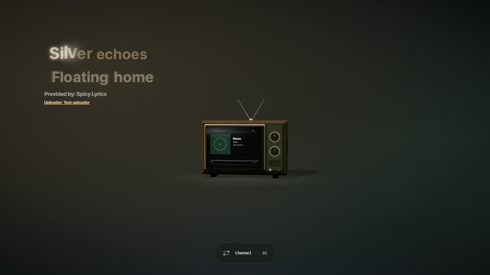
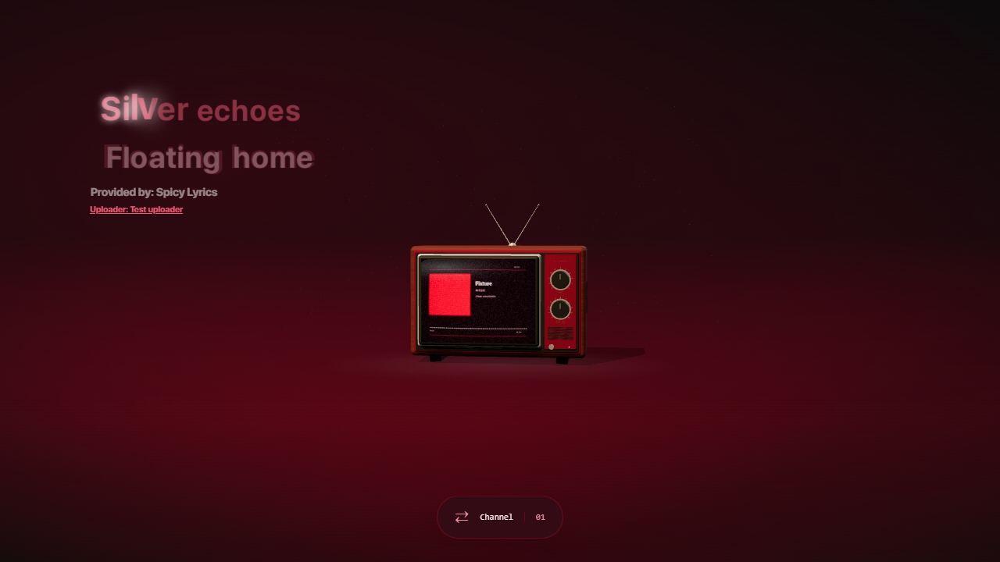
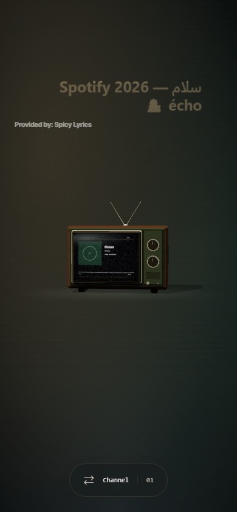
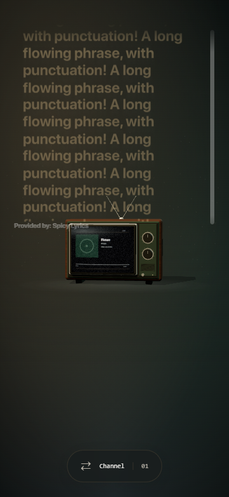

# Complete Spicy Lyrics renderer integration

The wallpaper now runs the complete rendering dependency graph from [Spikerko/spicy-lyrics](https://github.com/Spikerko/spicy-lyrics) commit `0ecf3925aac0e9b76b9095ee23b6d5118d9a18cc`. It replaces the earlier independent three/five-line and native-character implementations.

All 36 copied upstream files are complete and unchanged, including syllable/line/static builders, the full spring/spline animator and time setter, letter emphasis, interlude dots, backing vocals, duet alignment, virtualized smooth scrolling, SimpleBar, spring/scheduler/cleanup helpers and the original lyrics styles. `wallpaper/vendor/spicy-lyrics/UPSTREAM.json` records every file and its SHA-256 hash; the unit suite checks them byte for byte.

The host boundary is separate from the copied source. Build-time import resolution connects player/state/page interfaces to RetroWave's companion clock, appearance settings and provider controller. Logging, loading-state clearing and community-credit UI are adapted to this standalone host. Spotify and Spicetify are not required; a browser regression renders LRCLIB from a VLC-labelled companion fixture without a key or Spotify ID and verifies that `window.Spicetify` is absent. No Spicetify install or Spotify login is introduced. Clicking lyrics to seek the player is not exposed because the companion transport currently supplies read-only playback timing.

Spicy provider payloads retain original backing vocals, duet alignment, songwriters and uploader/maker attribution. LRCLIB line/static text is adapted without changing its timing granularity. Malformed syllable clocks retain their text as unclocked segments. Remote CSS/classes are stripped at the data boundary. The upstream long-syllable letter-emphasis algorithm is used as shipped; those visual letter subdivisions are not represented as provider character timestamps.

Text and glow use the same dominant cover hue as the television instead of choosing a competing palette swatch. Neutral remains white. The renderer label beneath the lyrics is removed; provider/creator attribution remains, with a source-code link in settings. Host CSS wraps long, mixed-direction and unbroken text, reserves space for animated line scaling and bounds very tall rows with internal scrolling. No lyric text is truncated. Smooth/Classic/Minimal modes map to the upstream renderer's full/simple/minimal behavior. Reduced motion and low power suppress transforms; the glow slider controls highlight glow.

## Build and verification

`node scripts/build-spicy.mjs` builds the actual copied modules and host adapters into `wallpaper/src/vendor/SpicyRenderer.mjs`. `pnpm build` invokes this before TypeScript and Vite. The renderer is loaded as its own production chunk. The pinned source, adapters, build script and licenses are available in the repository.

- TypeScript and production build passed.
- All 39 unit tests passed, including full-source hashes, provider data preservation and LRCLIB adaptation.
- All 40 Edge browser tests passed in one complete run; the final measured-height overflow refinement passed all six affected rendering/overflow checks. Coverage includes actual upstream spring/letter output, duets/backing vocals, interlude dots, virtualized static lyrics, cover hue and neutral color, RTL/mixed/long/unbroken content, vertical scrolling, malformed timing, companion authentication/staleness, pause/seek, obsolete responses, LRCLIB permission, settings persistence, input, TV controls and WebGL recovery.
- Browser screenshot fixtures are fictional and do not establish installed Lively input or real GSMTC playback qualification.

The combined wallpaper is AGPL-3.0; the original RetroWave MIT grant is preserved in `LICENSE-MIT`. Copied upstream and Fraktality spring notices are retained. The native companion does not contain copied renderer code.

